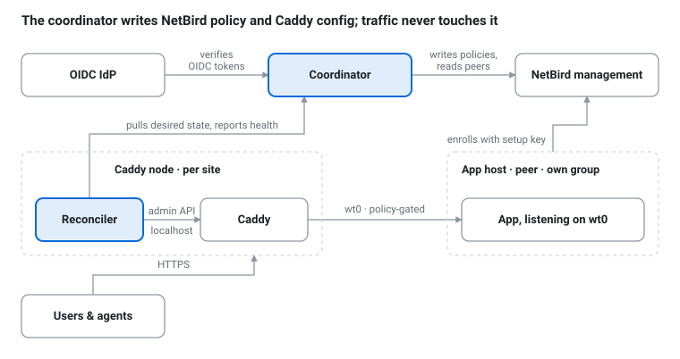

# Forecaddie

**Publish apps through Caddy over a NetBird mesh — approval-gated, no LAN exposure, no hand-edited upstreams.**

> **Status: design phase.** There is no working code yet. The [requirements](docs/requirements.md) and [system design](docs/design.md) are the project so far, and comments on them are welcome in [Discussions](../../discussions). Code lands once the design has been proven end to end on a reference deployment.

## The problem

A reverse proxy on a homelab needs to reach every app it publishes, so every app host ends up exposed on the LAN, the proxy config fills with LAN addresses that break on every move, hosts get no protection from each other, and traffic between proxy and app is plaintext.

## The idea

Hosts join a [NetBird](https://netbird.io) mesh. A small **coordinator** keeps a registry of apps (which peer, which port, which hostname) and an approval state for each. Approving an app does two things atomically: it writes a NetBird policy allowing *only* the Caddy node to reach *only* that port on *only* that peer, and it renders a Caddy config fragment for the route, validates it, and reloads Caddy. Disabling reverses both. A **reconciler** on each Caddy node owns exactly one imported fragment and never touches the rest of your Caddyfile.

The result: an app is reachable from its Caddy node, on its declared port, while approved, and from nowhere else. Hosts bind to the overlay interface and can drop every inbound LAN connection except SSH. Caddy's config never contains a LAN address, so hosts and sites can move freely.



## Scope decisions, stated up front

- **Caddy is the edge.** Forecaddie writes a Caddyfile fragment and uses caddy-security for request-level auth. There are no plans for Traefik or nginx.
- **NetBird is the transport.** Identity, enrollment, and policy enforcement come from NetBird. The transport sits behind a [driver interface](docs/design.md#transport-driver-interface) with a declarative policy call, so a Tailscale or Headscale driver is possible later, but none is planned.
- **External OIDC only.** No local accounts. Humans use authorization-code flow; agents use client-credentials. Roles come from a group claim.
- **Agent-friendly API.** Everything the UI does is a REST endpoint with an OpenAPI description, idempotency keys, and a one-call summary of what needs attention.
- **L4 passthrough** (TCP by SNI or dedicated port, UDP by dedicated port) via caddy-l4, which is pre-1.0 and documented as such.

## Documents

- [Requirements](docs/requirements.md) — purpose, scope, functional and non-functional requirements, rejected alternatives, open questions
- [System design](docs/design.md) — components, data model, approval flow, Caddy fragment contract, NetBird integration, driver interface, health model, identity and RBAC, API, enrollment, failure modes, rollout plan

Both documents include machine-readable JSON renderings of the diagrams for agents.

## Planned layout

```
cmd/forecaddie/             coordinator: API, UI, registry, policy writer
cmd/forecaddie-reconciler/  per-Caddy-node reconciler
internal/transport/         driver interface; netbird/ is the first driver
internal/render/            Caddyfile fragment templates
docs/                       design documents and the forecaddie.dev site
```

## License

[Apache-2.0](LICENSE). Contributions are accepted under the same license; there is no CLA.
