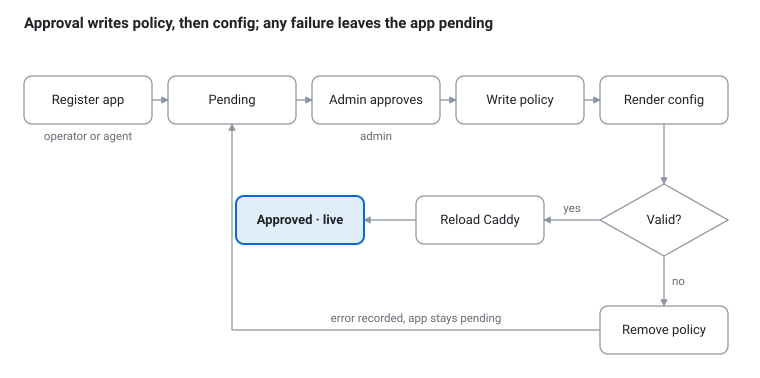

# Forecaddie

**Publish apps through Caddy over a NetBird mesh — approval-gated, no LAN exposure, no hand-edited upstreams.**

Forecaddie is a small coordinator for self-hosters who run Caddy as their edge and want every published app to be reachable *only* from Caddy, *only* on its port, *only* while approved — and want that to keep working when hosts and sites move.

> Status: design phase. No working code yet. The documents below are the project; feedback is welcome on [GitHub Discussions](https://github.com/Forecaddie/forecaddie/discussions).

## Documents

- [Requirements](requirements.md)
- [System design](design.md)

## How it works

Hosts join a NetBird mesh. The coordinator keeps a registry of apps and an approval state for each. Approving an app writes a NetBird policy (Caddy node → that peer, that port) and renders a Caddy config fragment, validates it, and reloads Caddy — as one transaction. The reconciler on each Caddy node owns exactly one imported fragment and never touches the rest of your Caddyfile.

## Source

[github.com/Forecaddie/forecaddie](https://github.com/Forecaddie/forecaddie) · Apache-2.0
